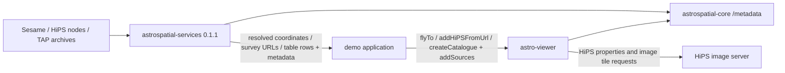

# Astronomy demos roadmap — review 2026-11-05

The first review consolidated A00 scenes 01–07. The next follow-up audited captions across 01–12, preserved camera continuity into 08, and expanded 09 into three clickable saved views. The broader external-service narrative remains future work. `?mode=video&end=07` stops at the review boundary; it does not enter TAP or the later scenes.

## Narrative order

1. **A08 architecture prelude** (planned expansion): first show AstroViewer and its scientific dependencies, then add astrospatial-services alongside it. Explain ownership before showing service integration.
2. **A00 visual showcase**: navigation, surveys, compositing, coordinates, grids, catalogues and footprints; then, after review, services, scientific state and FITS. Keep actual public API calls and provenance visible.
3. **Focused tutorials**: A01–A11 preserve their current IDs and implementations; add A12–A14 for service integration rather than overloading viewer-only tutorials.

## Installed dependency graph

Verified against the installed package manifests and exports (not aspirational APIs):

```mermaid
flowchart TD
  D[astro-viewer-demos] --> V[astro-viewer 3.17.0]
  V --> J[jsfitsio 3.1.0 — FITS parsing]
  V --> W[wcslight 3.1.4 — WCS utilities]
  V --> C[astrospatial-core 0.4.2]
  C --> H[/healpix — sky geometry and pixels]
  C --> M[/metadata — columns and metadata]
  W --> J
  W --> C
```

The next frame adds the independent retrieval path:



Do not imply the services package renders imagery, or that the viewer cannot fetch its own HiPS tiles. `wcslight` is a declared dependency; the diagrams do not claim every component runs in every scene.

## Demo catalogue

| ID | Scope | Status / next step |
| --- | --- | --- |
| A00 | Astronomy Showcase | Consolidate 01–07 now; next review 08–12 and insert architecture prelude before service content. |
| A01 | Navigation & FoV | Existing: camera, position and angular framing. |
| A02 | HiPS Surveys | Existing: public loading, switching and opacity API. Add explicit palette reset and URL ownership notes. |
| A03 | Grids & Coordinates | Existing: equatorial / HEALPix, centre and cursor. |
| A04 | Catalogues | Existing: source metadata, persistent multi-selection. |
| A05 | Observations & Footprints | Existing: STC-S and HST observation metadata. |
| A06 | Interaction Colours | Existing: distinguish catalogue / footprint normal, hover and selected states. |
| A07 | Scientific View State | Existing: save and restore the complete scientific view (corrects the outdated framing-only roadmap). |
| A08 | Developer Integration / architecture | Existing minimal embedding; expand with the two dependency diagrams above. |
| A09 | Inside the Sphere | Existing. |
| A10 | Camera Controls | Existing. |
| A11 | State Management | Existing. |
| A12 | Sesame → viewer | Planned: `SesameService.resolve("M51")`, show returned coordinates / resolver, pass to `viewer.flyTo`; explicit no-match / timeout. |
| A13 | HiPS node → viewer | Planned: `HiPSNodeService.listSurveys(nodeUrl)` and `getProperties(url)`; display metadata, choose a survey, pass its URL to `viewer.addHiPSFromUrl`. |
| A14 | TAP / ADQL → catalogue | Planned focused demo: show endpoint, ADQL, request, VOTable FIELD/TABLEDATA and catalogue metadata; live / fallback status visible throughout. |

A12–A14 are roadmap entries, not implemented demos. Their classes and methods already exist in installed astrospatial-services 0.1.1. A00 scene 08 already uses `TapService.querySync` and `parseVOTable`; it is not a mock. Its JSON and CSV steps are intentionally local fixtures, separate from the live TAP result.

## Should ensureLayer become viewer API?

`ensureLayer` currently belongs to the demo: cache by scene alias, reuse equal URLs, initialise opacity to zero. The public calls underneath are `viewer.addHiPSFromUrl(url)`, `viewer.setActiveHiPS(layer)` and `viewer.setHiPSOpacity(layer, value)`. It is no longer shown as a viewer command in A00 captions.

Recommendation: keep scene aliases, fade timing and narrative policy in demos. Consider an upstream **get-or-add HiPS by canonical URL** primitive only after defining concurrent-request deduplication, URL equivalence, abort / timeout semantics, ownership after `restoreState`, disposal and whether format/palette are instance state. Do not silently change `addHiPSFromUrl` semantics: callers may intentionally want independent layers of the same survey. No new viewer API is claimed or implemented here; no sibling repository is modified.

## Acceptance for the future service demos

- A real browser network request and parsed response, not an animated fixture labelled live.
- Returned metadata drives the viewer data mapping.
- Explicit errors / empty results and a visibly labelled optional fixture fallback.
- Public API snippets, endpoint / dataset links and provider attribution.
- A recorded network assertion plus visual review; do not equate HTTP 200 with useful sky coverage.
